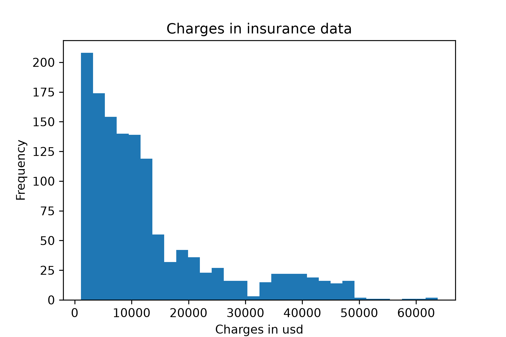
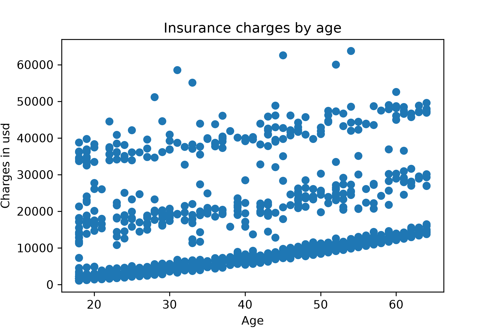
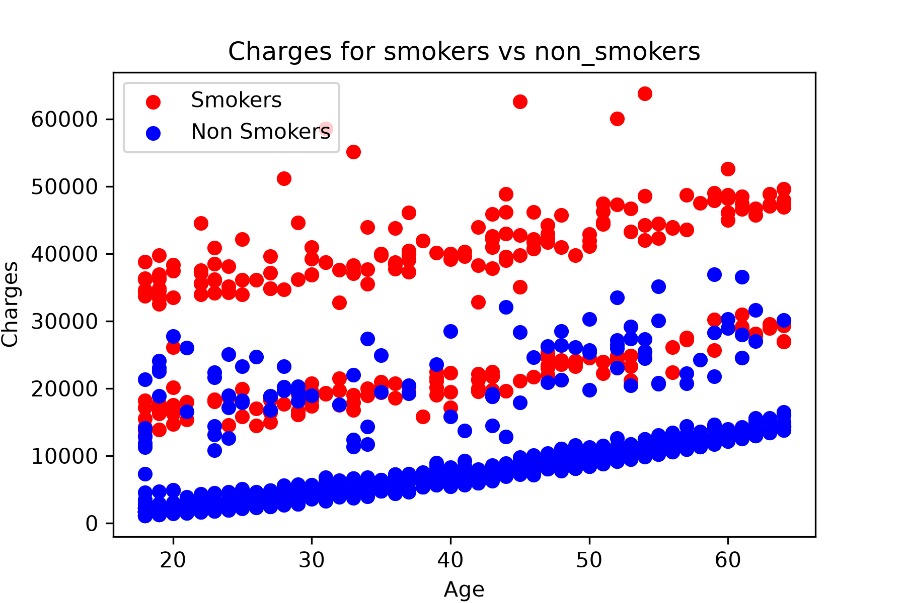
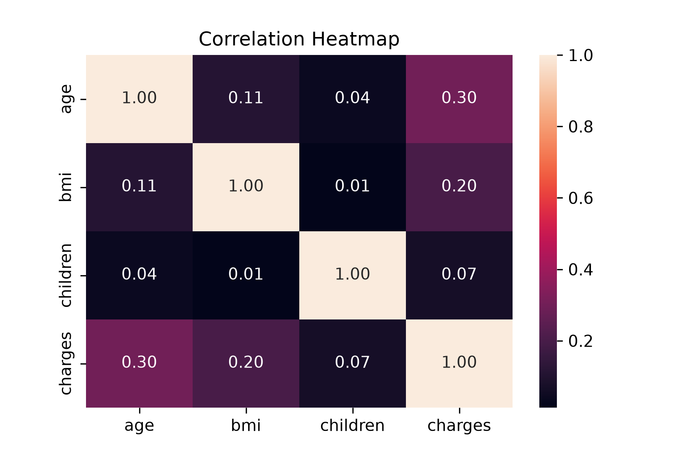
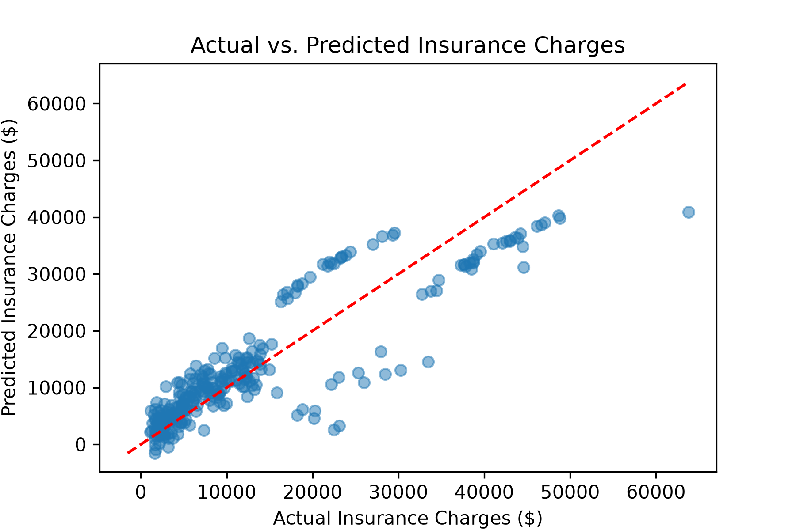
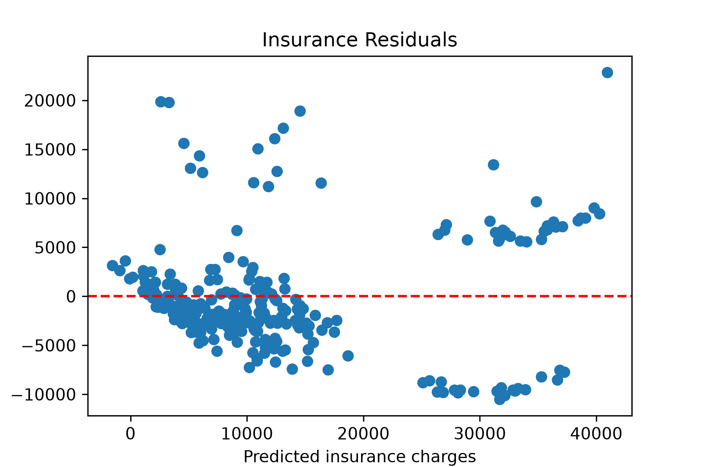

# Insurance Cost Prediction

## Project Overview

The goal of this project is to predict medical insurance charges and visualize existing data to identify relationships between insurance costs and features such as age, BMI, smoking status, and region. The project utilizes exploratory data analysis (EDA) to examine patterns in the dataset and Linear Regression to develop a predictive model. Model performance is evaluated using Mean Absolute Error (MAE), Root Mean Squared Error (RMSE), R², and residual analysis to assess prediction accuracy and identify potential limitations.

## Dataset

The dataset consists of 1,338 observations and 7 columns. Six columns represent the input features: age, sex, BMI, number of children, smoking status, and region. The seventh column, `charges`, serves as the target variable and represents individual medical insurance charges in USD.

## Technologies Used

- **Python:** The primary programming language used to develop the project.
- **Pandas:** Used to load, organize, and analyze the insurance dataset.
- **NumPy:** Used for numerical operations and combining feature arrays.
- **Matplotlib:** Used to create and save data visualizations.
- **Seaborn:** Used to generate a correlation heatmap for numerical variables.
- **Scikit-learn:** Used for data preprocessing, train-test splitting, Linear Regression model training, and performance evaluation.

## Methodology

The project began with exploratory data analysis (EDA), examining the dataset's structure, descriptive statistics, missing values, and correlations between numerical variables.

The data was then prepared by separating the six input features from the target variable, `charges`. An 80/20 train-test split was implemented, allocating 80% of observations to model training and 20% to testing.

Categorical variables, including smoking status, sex, and region, were converted into numerical features using one-hot encoding. The encoder was fitted exclusively on the training data and then applied to the testing data to prevent data leakage.

A Linear Regression model was trained using the processed training dataset. Model performance was evaluated on the testing dataset using Mean Absolute Error (MAE), Root Mean Squared Error (RMSE), and R². Residual analysis was also performed to identify patterns in prediction errors and potential limitations of the model.


## Model Performance

The Linear Regression model achieved the following results on the testing dataset:

| Metric | Result |
|---|---|
| Mean Absolute Error (MAE) | $4,181.19 |
| Root Mean Squared Error (RMSE) | $5,796.28 |
| R² Score | 0.7836 |

The model has limitations, with predictions differing from actual insurance charges by approximately $4,181 on average. RMSE was higher than MAE, indicating that some predictions had relatively large errors.

These errors are also visible in the residual plot, which shows patterns suggesting that the Linear Regression model may not fully capture the relationships between the input features and insurance charges.

Despite these limitations, the model explained approximately 78.36% of the variation in insurance charges within the testing dataset.

## Visualizations

### 1. Insurance Charges Distribution

This histogram illustrates the distribution of medical insurance charges and the frequency of observations within different charge ranges.



### 2. Insurance Charges by Age

This scatterplot illustrates the relationship between age and medical insurance charges. The data demonstrates a weak positive correlation (r ≈ 0.299), suggesting that insurance charges generally tend to increase with age.



### 3. Insurance Charges: Smokers vs. Non-Smokers

This scatterplot compares medical insurance charges between smokers and non-smokers. The data reveals that smokers generally have significantly higher insurance charges, averaging approximately $32,050 compared to $8,434 for non-smokers.



### 4. Correlation Heatmap

The correlation heatmap illustrates the relationships between age, BMI, number of children, and medical insurance charges. Age demonstrates the strongest positive correlation with insurance charges (r ≈ 0.299), followed by BMI (r ≈ 0.198) and number of children (r ≈ 0.068). Overall, these variables exhibit relatively weak positive correlations with insurance charges.



### 5. Actual vs. Predicted Insurance Charges

This scatterplot compares actual medical insurance charges against the values predicted by the Linear Regression model. Predictions closer to the diagonal reference line indicate greater accuracy, while points farther from the line represent larger prediction errors.



### 6. Residual Analysis

The residual plot illustrates the differences between actual and predicted insurance charges relative to a zero-error reference line. Positive residuals indicate that the model underestimated insurance charges, while negative residuals indicate overestimation. Patterns in the residual distribution suggest that the Linear Regression model may not fully capture the complexity of the dataset.



## Key Findings

1. **Age and Insurance Charges:** Age demonstrated the strongest positive correlation with insurance charges among the numerical input features (r ≈ 0.299), followed by BMI and number of children.

2. **Smoking Status:** Smokers had substantially higher average insurance charges ($32,050) compared to non-smokers ($8,434), suggesting that smoking status is an important predictor of insurance costs.

3. **Model Limitations:** Although the Linear Regression model explained approximately 78.36% of the variation in insurance charges, residual analysis revealed patterns in prediction errors. Future improvements could include additional relevant features, interaction terms, and more advanced regression models to improve predictive accuracy.

## How to Run

### 1. Clone the Repository

Clone the GitHub repository to your local computer.

```bash
git clone https://github.com/etrykk/insurance-cost-prediction.git
cd insurance-cost-prediction
```

### 2. Install Dependencies

Install the required Python libraries using the `requirements.txt` file.

```bash
pip install -r requirements.txt
```

### 3. Run the Program

Execute the main Python script.

```bash
python src/main.py
```

### 4. View Results

The program performs exploratory data analysis, trains a Linear Regression model, and evaluates its performance using MAE, RMSE, and R².

The generated visualizations are saved in the `outputs/` directory for further analysis.
